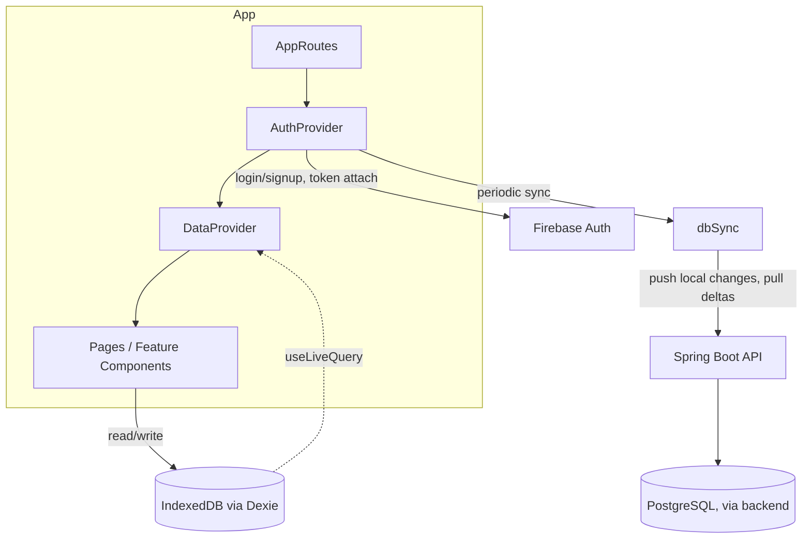
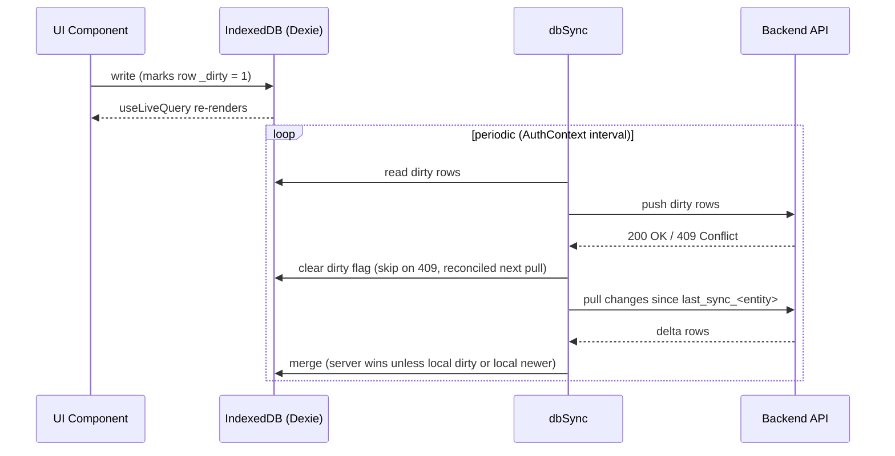
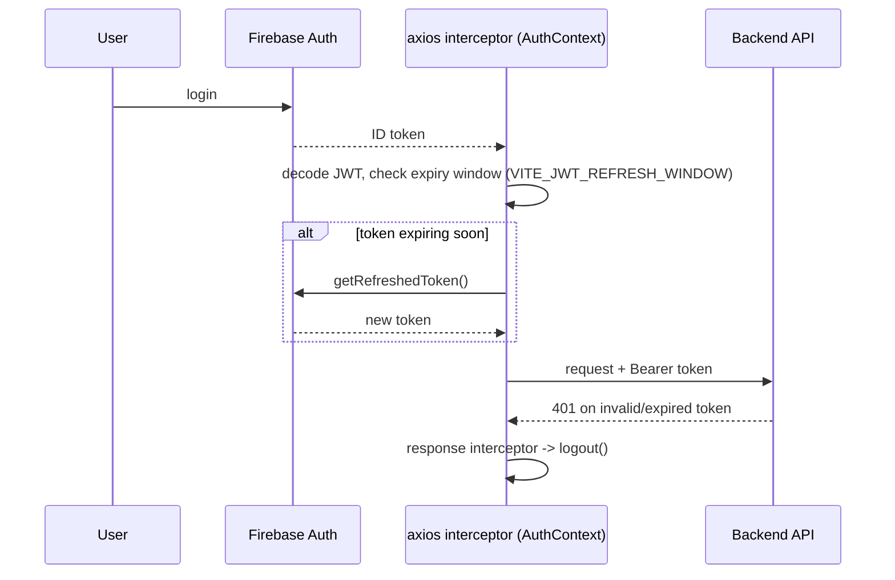

# Architecture — Habits Pomodoro (Frontend)

Vite / React 18 SPA for the Habits Pomodoro app. See the [root README](README.md) for the product concept. This document describes the code as it is today, including known rough edges, so it can serve as a map for refactoring.

## Stack

- **React 18** + **Vite** (migrated off Create React App — some CRA-era leftovers remain, see [Known gaps](#known-gaps))
- **Firebase Auth** — login/signup, ID token issuance
- **Dexie** (IndexedDB) — local-first offline data store; the app reads/writes local data and syncs with the backend in the background
- **Bootstrap 5** + `bootstrap-icons` — UI styling
- **Chart.js** — stats visualizations
- **axios** — HTTP client to the Spring Boot API
- **vite-plugin-pwa** — installable PWA + Firebase Cloud Messaging push notifications

## High-level structure



`AuthProvider` wraps `DataProvider` wraps the routed pages (`components/AppRoutes.jsx`). Both are React Contexts — there is no Redux/Zustand in this app.

## State management

**`services/auth/AuthContext.jsx`** currently owns three responsibilities at once:
1. Auth state (login/signup/logout, current user)
2. User settings
3. Axios interceptor lifecycle (attaching/refreshing the Firebase token on every request) and periodic sync scheduling

**`services/db/DataContext.jsx`** wraps Dexie's `useLiveQuery` to expose `projectsMap`, `tagsMap`, `categoriesMap`, `tasksMap`, and `todaysPomodoros` as live-updating `Map`s to the whole component tree. It blocks rendering until all five queries resolve.

Below these two contexts, state is passed via plain prop drilling — some components (e.g. the task-row component) take 8-9 props including setters relayed from several levels up.

## Local-first data flow (Dexie)

IndexedDB, not the API, is the primary read/write target for the UI. The backend is only touched by the sync layer (plus a few one-off direct calls).



- `dbRead.js` / `dbWrite.js` — all UI-facing local reads/writes
- `dbSync.js` — `syncDirtyItems` (push) and `syncDeltaItems` (pull), per entity
- `services/api/*ApiService.js` — thin per-entity axios wrappers used by the sync layer

This design is intentional (offline-first), not accidental duplication — but it's held together by comments/TODOs rather than tests.

## Auth & request flow



- Token refresh is proactive (checked before each request), which is good.
- If `getRefreshedToken()` itself fails, the error is currently unhandled inside the interceptor rather than triggering a clean logout — see [Known gaps](#known-gaps).

## Directory map

```
src/
├── components/
│   ├── AppRoutes.jsx        route table, wraps AuthProvider > DataProvider
│   ├── LoginComponent.jsx, SignupComponent.jsx, ...
│   ├── features/            core feature surface
│   │   ├── tasks/           task list, drag-reorder, pomodoro trigger
│   │   ├── projects/
│   │   ├── pomodoros/
│   │   ├── comments/
│   │   └── tags/
│   ├── stats/                charts + stats views (Chart.js)
│   └── user-settings/
└── services/
    ├── api/                 axios wrappers, one per backend entity
    ├── auth/                AuthContext, FirebaseAuthService
    ├── db/                  Dexie schema, read/write, sync (local-first layer)
    ├── hooks/                shared hooks
    ├── pagination/           custom pager (used instead of react-paginate)
    └── helpers/              misc formatting/mapping helpers
```

## Known gaps

Found during a code audit (2026-08); listed as concrete refactor/fix candidates rather than aspirational design:

1. **Likely broken audio:** `BreakTimerComponent.jsx` and `PomodoroComponent.jsx` reference `import.meta.env.PUBLIC_URL`, a Create React App convention not populated by Vite — pomodoro/break sound effects are probably silently broken since the CRA→Vite migration.
2. **`.env.example` is stale**, still listing the CRA-era `REACT_APP_SERVER_URL` instead of the ~9 `VITE_*` vars the app actually needs (see `services/firebaseConfig.js`).
3. Both periodic sync intervals in `AuthContext.jsx` are hardcoded to 1 hour, despite a comment implying the dirty-data push should run every 5 minutes.
4. Duplicated "which row's popup is open" `useState(-1)` pattern across ~10 components — candidate for a shared `usePopupId()` hook.
5. `BarChart`/`DoughnutChart` (and similar chart components) are ~90% identical — candidate for a shared `ChartCard` wrapper.
6. JWT refresh failure and malformed-token parsing are unhandled in the axios interceptor; `logout()` skips later cleanup steps if disabling the FCM token throws first.
7. No prop-types or TypeScript — no compile/runtime contract on component props despite several 8-9 prop components.
8. `react-paginate` is an unused dependency (the app uses its own `services/pagination/`).
